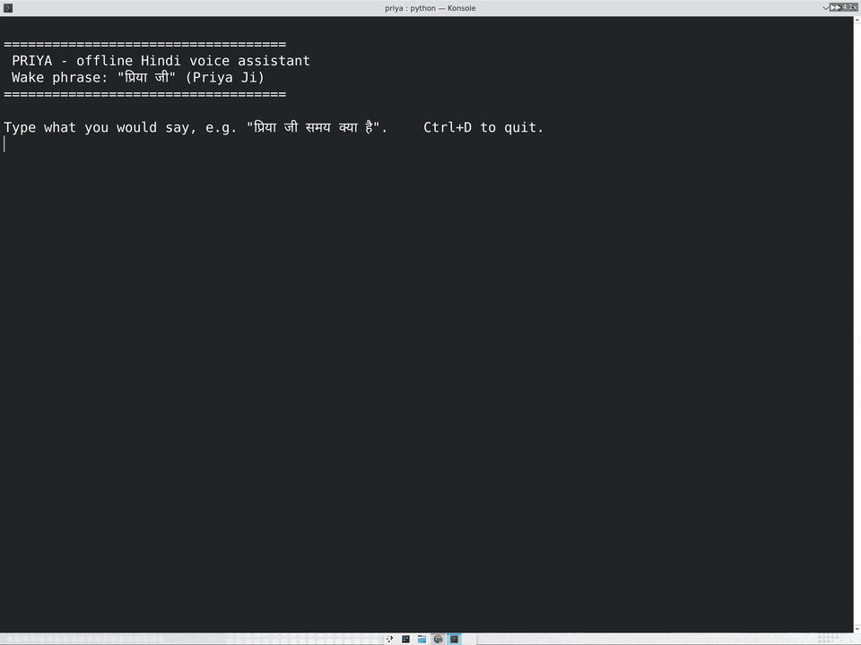
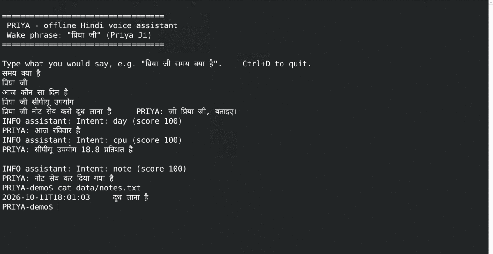
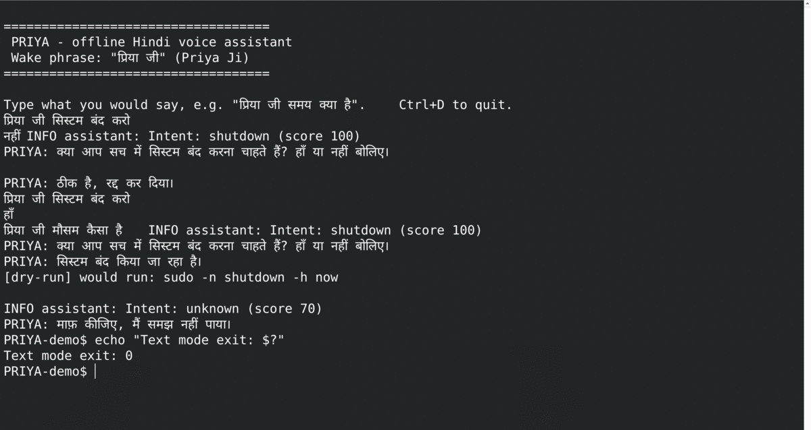
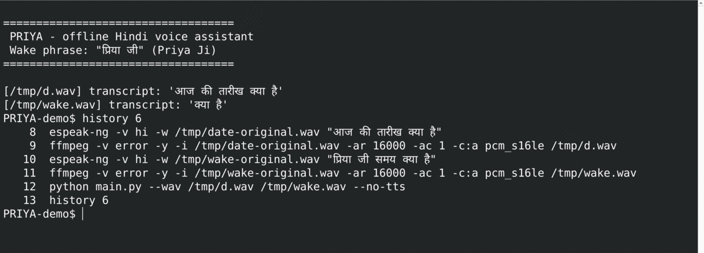
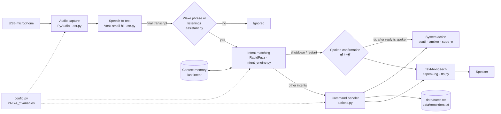

# PRIYA: offline Hindi voice assistant for Raspberry Pi

**P**rivacy-first **R**aspberry Pi-based **I**ntelligent **Y**ielding **A**I Assistant: a Hindi
voice assistant that does speech recognition, intent matching and speech output on the device,
without a cloud service.

[](https://github.com/bharathkrishna0/PRIYA-Privacy-first-Raspberry-Pi-based-Intelligent-Yielding-AI-Assistant/actions/workflows/ci.yml)

-orange)

[](LICENSE)

[Features](#features) · [Architecture](#architecture) · [Install](#installation-and-quick-start) ·
[Usage](#usage) · [Performance](#performance-and-evaluation) · [Privacy](#privacy-and-security) ·
[Testing](#testing) · [Contributing](#contributing)

Most voice assistants send your voice to a server. PRIYA is built for the opposite case: a
low-cost single-board computer that listens for the wake phrase **"प्रिया जी" (Priya Ji)**,
understands a set of spoken Hindi commands and answers in Hindi, with the audio never leaving the
device. It was built for the
[Bharat AI-SoC Student Challenge](docs/Bharat_AI-SoC_Student_Challenge_Certificate.pdf)
(Arm Education and the Chips to Startup Programme, MeitY, January–March 2026).

> **Status:** working prototype. The speech pipeline, intent engine and commands run and are
> covered by automated tests on Linux. Performance on Raspberry Pi has not been measured yet, and
> recognition has only been tested automatically with synthetic (espeak-ng) speech. See
> [Limitations](#roadmap-and-limitations).

## Demo

Terminal demo (44 s) recorded on a Linux PC with no microphone, **not on the Raspberry Pi**.
It shows text mode, WAV transcription with the real Vosk model, and the error messages. Click the
animation to open the MP4.

[](docs/media/priya-cli-demo.mp4)

| Text mode and saved note | Shutdown confirmation and unknown request | Synthetic WAV transcription |
|---|---|---|
|  |  |  |

In the screenshots the typed lines were pasted all at once, so they appear above the replies. The
WAV screenshot shows a real failure: espeak-ng audio of "प्रिया जी समय क्या है" was transcribed
as just "क्या है", so the wake phrase was missed (see [Limitations](#roadmap-and-limitations)).

> **Still to record:** a clip on the Raspberry Pi with a real voice and microphone ("प्रिया जी" →
> reply, "समय क्या है" → time, "सिस्टम बंद करो" → confirmation → "नहीं").

The same flow as text, from a session in text mode (`python main.py --text --no-tts`), captured on a
Linux development machine. Typed lines stand in for transcripts and are shown after `>`. The
`PRIYA:` lines are the program's actual output:

```text
Type what you would say, e.g. "प्रिया जी समय क्या है". Ctrl+D to quit.
> समय क्या है                          (ignored: no wake phrase)
> प्रिया जी
PRIYA: जी प्रिया जी, बताइए।
> आज कौन सा दिन है
PRIYA: आज रविवार है
> प्रिया जी सीपीयू उपयोग
PRIYA: सीपीयू उपयोग 2.5 प्रतिशत है
> प्रिया जी नोट सेव करो दूध लाना है
PRIYA: नोट सेव कर दिया गया है
> प्रिया जी सिस्टम बंद करो
PRIYA: क्या आप सच में सिस्टम बंद करना चाहते हैं? हाँ या नहीं बोलिए।
> नहीं
PRIYA: ठीक है, रद्द कर दिया।
```

## Features

### Implemented

| Feature | What it does | Where |
|---|---|---|
| Offline Hindi speech-to-text | Vosk (Kaldi) with the 42 MB `vosk-model-small-hi-0.22` model, run locally | `asr.py` |
| Wake phrase | Commands are only acted on after "प्रिया जी", either on its own or at the start of the command ("प्रिया जी समय क्या है"). Listening ends after one command or 10 s | `assistant.py` |
| Fuzzy intent matching | RapidFuzz similarity against example phrases, so small recognition errors still match. Out-of-scope requests fall below a threshold and get "समझ नहीं पाया" | `intent_engine.py` |
| Spoken replies | espeak-ng Hindi voice. Capture pauses while PRIYA speaks so she doesn't transcribe herself | `tts.py`, `main.py` |
| System status | Time, date and weekday in Hindi; CPU, memory and disk usage; battery if present (via `psutil`) | `actions.py` |
| Volume control | "आवाज़ बढ़ाओ" / "आवाज़ कम करो" through `amixer` | `actions.py` |
| Safe shutdown/restart | Asks for a spoken "हाँ" first and uses fixed `sudo -n` commands. Can be disabled | `assistant.py`, `actions.py` |
| Notes and reminders | Saves the text after (or before) the trigger phrase, with a timestamp, to `data/notes.txt` / `data/reminders.txt` | `actions.py` |
| Context memory | "प्रिया जी और" repeats the last command (e.g. ask the time again) | `assistant.py` |
| Restricted grammar mode | Optional: limits Vosk to known phrases. Much faster and more robust, but disables free-text notes | `asr.py`, `intent_engine.py` |
| Hardware-free modes | `--text` (type transcripts) and `--wav` (feed recordings) for development and testing | `main.py` |

### Planned (not implemented)

Reminder alarms that speak at a set time, arithmetic ("दो और दो जोड़ो"), opening and closing apps,
and a dedicated low-power wake-word engine. See the [roadmap](#roadmap-and-limitations).

## Architecture



| Component | Responsibility | File |
|---|---|---|
| Entry point | Parses options, chooses microphone, `--text` or `--wav` mode, runs the main loop, pauses capture while speaking, reports a missing model or microphone clearly | `main.py` |
| Configuration | All tunables (model path, mic index, sample rate, wake words, threshold, timeouts, TTS voice, mixer control, data folder) with `PRIYA_*` overrides | `config.py` |
| Speech recognition | Checks the model folder, opens the microphone at its native rate and hands that rate to Vosk (which resamples to 16 kHz), returns finished utterances | `asr.py` |
| Conversation logic | Wake phrase, one-command listening window, follow-up, confirmation for power commands, timeouts. No audio or hardware imports, so it is unit-tested with strings | `assistant.py` |
| Intent engine | Normalises text, matches note/reminder triggers, scores other phrases with `fuzz.ratio`, yes/no detection, grammar list | `intent_engine.py` |
| Actions | Builds Hindi replies and runs allow-listed commands through an injectable `runner` | `actions.py` |
| Speech output | Calls `espeak-ng` without a shell; keeps working (text only) if it's missing | `tts.py` |

Wake-phrase detection runs on the Vosk transcript. There is no separate wake-word engine, so the
recogniser transcribes everything it hears, locally, and ignores it unless the phrase is present.

### Engineering decisions

- **On-device ASR (Vosk/Kaldi) instead of a cloud API:** privacy, no internet needed, no API costs.
  The small Hindi model is 42 MB on disk and used ~161 MB of RAM in our measurement, which fits a
  Raspberry Pi. The cost is accuracy: the model's published WER is 20.9% (IITM) and 24.7% (MUCS).
- **Fuzzy matching instead of an NLU model:** a few dozen example phrases and RapidFuzz work in
  under a millisecond with no training data, and they tolerate the recogniser's substitution
  errors. The trade-off is that a phrase has to be close to a whole example. Unrelated sentences
  can also score high, which is why the threshold was raised to 75 (see
  [benchmarks](docs/BENCHMARKS.md#intent-threshold)).
- **Restricted grammar as an option:** narrowing Vosk to the command phrases made decoding ~30x
  faster on our test machine. It isn't the default because free-text notes need the open
  vocabulary.
- **espeak-ng for speech output:** tiny, offline and packaged in Raspberry Pi OS. It sounds
  robotic; neural TTS would be heavier.
- **Confirmation and allow-listing for system commands:** a misheard phrase must never power off
  the device, so shutdown/restart need an explicit "हाँ", and only fixed argument lists are executed.

## Hardware and software requirements

| | Requirement | Evidence |
|---|---|---|
| Board | Raspberry Pi. Designed for Raspberry Pi 5 | Author's setup; no measured results yet. Other boards untested |
| OS | Raspberry Pi OS **64-bit** | Author's setup. CI runs on Ubuntu x86-64 |
| Python | 3.9 or newer (Raspberry Pi OS Bookworm ships 3.11) | CI tests 3.9, 3.11 and 3.13 |
| Microphone | Any ALSA-compatible USB microphone (required) | Model and brand not yet documented |
| Speaker | 3.5 mm, HDMI or USB audio output (required for spoken replies) | |
| Storage | ~100 MB for the model and dependencies | Model is 42 MB zipped |
| Optional | Battery/UPS HAT (battery command); passwordless `sudo` (shutdown/restart) | |

System packages: `espeak-ng` (speech output), `portaudio19-dev` and `python3-dev` (to build
PyAudio), `alsa-utils` (`amixer`, `arecord`; preinstalled on Raspberry Pi OS), `unzip`, `wget`.

## Installation and quick start

```bash
# 1. Clone
git clone https://github.com/bharathkrishna0/PRIYA-Privacy-first-Raspberry-Pi-based-Intelligent-Yielding-AI-Assistant.git priya
cd priya

# 2. System packages
sudo apt update
sudo apt install -y espeak-ng portaudio19-dev python3-dev python3-venv alsa-utils unzip wget

# 3. Python environment and dependencies
python3 -m venv .venv
source .venv/bin/activate
pip install -r requirements.txt

# 4. Speech model (vosk-model-small-hi-0.22, Apache-2.0) -> ./model
./scripts/download_model.sh

# 5. Find your microphone and its sample rate
python main.py --list-devices
export PRIYA_INPUT_DEVICE=1        # index from the list, if not the default device
export PRIYA_SAMPLE_RATE=44100     # a rate your microphone supports (often 44100 or 48000)

# 6. Start
python main.py
```

Then say **"प्रिया जी"**, wait for "जी प्रिया जी, बताइए।", and say **"समय क्या है"**.

To try it without a microphone: `python main.py --text` (shutdown/restart/volume are only printed
in this mode).

### Configuration

Set these as environment variables. All are optional.

| Variable | Default | Meaning |
|---|---|---|
| `PRIYA_MODEL_PATH` | `./model` | Vosk model folder |
| `PRIYA_INPUT_DEVICE` | system default | PyAudio input device index |
| `PRIYA_SAMPLE_RATE` | `44100` | Microphone capture rate (passed to Vosk) |
| `PRIYA_FRAMES_PER_BUFFER` | `4096` | Audio chunk size |
| `PRIYA_WAKE_WORDS` | `प्रिया जी` | Comma-separated wake phrases (must be words in the Vosk vocabulary) |
| `PRIYA_INTENT_THRESHOLD` | `75` | Minimum RapidFuzz score (0–100) |
| `PRIYA_USE_GRAMMAR` | `false` | Restrict Vosk to known phrases (faster; disables free-text notes) |
| `PRIYA_LISTEN_TIMEOUT_S` | `10` | How long to wait for a command after the wake phrase |
| `PRIYA_CONFIRM_TIMEOUT_S` | `15` | How long a shutdown/restart confirmation stays open |
| `PRIYA_ENABLE_POWER_COMMANDS` | `true` | Set `false` to disable shutdown/restart |
| `PRIYA_MIXER_CONTROL` / `PRIYA_VOLUME_STEP` | `Master` / `10` | `amixer` control and step (%) |
| `PRIYA_TTS_VOICE` / `PRIYA_TTS_SPEED` | `hi` / espeak default | espeak-ng voice and words per minute |
| `PRIYA_DATA_DIR` | `./data` | Where notes and reminders are written |
| `PRIYA_LOG_LEVEL` | `INFO` | `DEBUG` also logs transcripts |

### Troubleshooting

| Symptom | Fix |
|---|---|
| `Vosk model at 'model' is missing ...` | Run `./scripts/download_model.sh` |
| `Could not open microphone ... Invalid sample rate` | Set `PRIYA_SAMPLE_RATE` to the default rate shown by `--list-devices` |
| `Invalid input device` | Plug in the USB mic, check `arecord -l`, and set `PRIYA_INPUT_DEVICE` |
| Nothing happens when you speak | Run with `PRIYA_LOG_LEVEL=DEBUG` to see transcripts. Test the mic with `arecord -d 3 t.wav && aplay t.wav`. Speak the wake phrase clearly as two words |
| `pip install pyaudio` fails | `sudo apt install portaudio19-dev python3-dev`, then retry |
| No spoken reply | Check `espeak-ng -v hi "नमस्ते"` and the output device (`raspi-config` → System → Audio) |
| Shutdown says it failed | The user needs passwordless sudo for `shutdown`/`reboot`. PRIYA uses `sudo -n` and never prompts |
| ALSA/JACK warnings at start | Usually harmless messages from PortAudio probing devices |

## Usage

| Say (after "प्रिया जी") | Intent | Reply / action | Status |
|---|---|---|---|
| समय क्या है · अभी कितने बजे हैं · समय बताओ | `time` | Current time (HH:MM) | Implemented, tested |
| आज की तारीख क्या है · तारीख बताओ | `date` | Date with Hindi month name | Implemented, tested |
| आज कौन सा दिन है | `day` | Weekday in Hindi | Implemented, tested |
| सीपीयू उपयोग · सिस्टम लोड | `cpu` | CPU usage % | Implemented, tested |
| मेमोरी उपयोग · रैम उपयोग | `memory` | RAM usage % | Implemented, tested |
| डिस्क उपयोग · स्टोरेज कितना है | `disk` | Root filesystem usage % | Implemented, tested |
| बैटरी स्थिति · बैटरी कितनी है | `battery` | Battery % or "not available" (a bare Pi has no battery) | Implemented, tested |
| सिस्टम जानकारी | `system_info` | CPU and memory % | Implemented, tested |
| आवाज़ बढ़ाओ / आवाज़ कम करो | `volume_up` / `volume_down` | `amixer sset Master 10%+/-` | Implemented, unit-tested; not yet verified on a Pi |
| सिस्टम बंद करो / सिस्टम रीस्टार्ट करो | `shutdown` / `restart` | Asks for confirmation; "हाँ" → `sudo -n shutdown -h now` / `sudo -n reboot` | Implemented, tested (command mocked) |
| नोट सेव करो … · नोट लिखो … · … लिख लो | `note` | Appends the text to `data/notes.txt` | Implemented, tested |
| रिमाइंडर सेट करो … | `reminder` | Appends the text to `data/reminders.txt` (no alarm yet) | Implemented, tested |
| मजाक सुनाओ · जोक सुनाओ | `joke` | A joke | Implemented, tested |
| प्रेरणा दो · मोटिवेशन दो | `motivation` | A motivational line | Implemented, tested |
| नमस्ते · हेलो / कैसे हो / धन्यवाद · शुक्रिया / बात करो | `greeting` / `wellbeing` / `thanks` / `conversation` | Small talk | Implemented, tested |
| और | follow-up | Repeats the last command | Implemented, tested |
| गणना करो, ऐप खोलो/बंद करो | — | — | Planned |

Other modes:

```bash
python main.py --text            # type transcripts; system commands are printed (dry run)
python main.py --wav a.wav b.wav # transcribe mono 16-bit WAVs with Vosk, one utterance each
python main.py --dry-run         # microphone mode, but print system commands instead of running them
python main.py --no-tts          # print replies instead of speaking
```

## Performance and evaluation

Measured with [`benchmarks/run_benchmark.py`](benchmarks/run_benchmark.py) on an x86 cloud VM
(Xeon 8375C, 8 vCPU), using 22 phrases synthesised with espeak-ng. **These are not Raspberry Pi
numbers.**

| Mode | Model load | Model RAM | Real-time factor | Intent accuracy (synthetic speech) |
|---|---|---|---|---|
| Open vocabulary (default) | ~1.0 s | ~161 MB | ~1.6 | 12/22 |
| Restricted grammar | ~1.1 s | ~161 MB | ~0.05 | 20/22 |

Synthetic speech is a pipeline check, not a measure of accuracy on real voices. The Raspberry Pi
measurements (latency, CPU, memory, accuracy on human speakers) are still missing.
[docs/BENCHMARKS.md](docs/BENCHMARKS.md) has the full method, raw observations and the procedure to
fill them in.

## Privacy and security

- **Where audio is processed:** on the device. Audio goes from the microphone into Vosk in memory
  and is discarded after recognition. Audio is never written to disk.
- **Network:** the Python code makes no network requests (no HTTP or socket libraries are
  imported). The only download is the one-time model fetch in `scripts/download_model.sh`. After
  that PRIYA works without a network connection. The Vosk and espeak-ng native libraries were not
  separately audited.
- **What is stored:** only the text of notes and reminders you dictate, with timestamps, in plain
  text under `PRIYA_DATA_DIR` (git-ignored). Transcripts are printed to logs only at `DEBUG` level.
- **Always listening:** because the wake phrase is detected from transcripts, everything spoken
  near the microphone is transcribed locally while PRIYA runs.
- **Permissions:** access to the audio device (the default Raspberry Pi OS user is in the `audio`
  group); `sudo` without a password only if you want shutdown/restart.
- **System commands:** only fixed argument lists (`sudo -n shutdown -h now`, `sudo -n reboot`,
  `amixer -q sset <control> <n>%±`), run without a shell. Transcript text is never placed in a
  command. Shutdown and restart need a spoken "हाँ", and `PRIYA_ENABLE_POWER_COMMANDS=false`
  disables them.
- **Remaining limitations:** no speaker verification (anyone near the device can give commands),
  notes are unencrypted, and fuzzy matching can still mishear a command.

Report vulnerabilities privately as described in [SECURITY.md](SECURITY.md).

## Project structure

```text
.
├── main.py                 # entry point: microphone / --text / --wav modes
├── assistant.py            # conversation state machine (wake, confirm, follow-up)
├── intent_engine.py        # phrase lists, fuzzy matching, yes/no, grammar
├── actions.py              # replies and allow-listed system commands
├── asr.py                  # Vosk model check, microphone stream, WAV transcription
├── tts.py                  # espeak-ng wrapper
├── config.py               # settings and PRIYA_* overrides
├── scripts/download_model.sh
├── benchmarks/             # run_benchmark.py, phrases.tsv, results/ (git-ignored)
├── tests/                  # pytest suite (unit + optional speech end-to-end)
├── docs/                   # BENCHMARKS.md, PORTFOLIO.md, certificate
├── .github/                # CI workflow, issue and PR templates
├── requirements.txt        # runtime dependencies
└── requirements-dev.txt    # test/lint dependencies (no PyAudio needed)
```

`model/` (downloaded) and `data/` (notes) are created locally and git-ignored.

## Testing

```bash
pip install -r requirements-dev.txt
ruff check . && ruff format --check .
python -m pytest -q                 # unit tests: no microphone, model or Pi needed
python -m pytest -m e2e -rs         # espeak-ng audio -> Vosk -> intent (needs ./model and espeak-ng)
```

CI ([`.github/workflows/ci.yml`](.github/workflows/ci.yml)) runs lint and unit tests on Python
3.9, 3.11 and 3.13, plus the speech end-to-end test and benchmark with the real model.

## Engineering highlights

- **Edge speech pipeline:** streaming microphone audio into Kaldi-based recognition on a
  single-board computer, with the capture rate handled correctly (the original code decimated
  44.1 kHz to 14.7 kHz and labelled it 16 kHz).
- **Measured trade-offs:** a reproducible benchmark showed restricted-grammar decoding ~30x faster
  than open vocabulary on the test machine, and it documents what that costs.
- **Safety by design:** spoken confirmation, an allow-list and no shell for anything that touches
  the system.
- **Testable embedded code:** hardware access is injected or imported lazily, so 100+ tests run on
  any laptop or CI runner. A separate test drives real Vosk with synthesised Hindi audio.
- **Debugging:** found and fixed a crash on the first command, an unloadable committed model, the
  assistant transcribing her own voice, and wake words that the model's vocabulary cannot produce.

A short resume/portfolio summary is in [docs/PORTFOLIO.md](docs/PORTFOLIO.md).

## Roadmap and limitations

**Done:** offline Hindi ASR, wake phrase, 20 intents, notes/reminders, volume, confirmed
shutdown/restart, configuration, tests, CI, benchmark tooling.

**Known limitations**

- Not yet measured on Raspberry Pi; open-vocabulary decoding was slower than real time on the test
  VM.
- The wake phrase was not recognised from espeak-ng speech; it needs testing with human speakers.
- Fuzzy matching needs utterances close to an example phrase; no real NLU.
- Reminders are saved but never announced.
- espeak-ng's voice is robotic; no speaker verification.

**Next steps (prioritised)**

1. Measure on the Raspberry Pi (latency, CPU, RAM) and record a demo video.
2. Record real speakers for the phrases in `benchmarks/phrases.tsv` and tune the threshold and
   phrase lists on them.
3. Decide between grammar mode as default and a hybrid (grammar for commands, open vocabulary
   only after "नोट").
4. Spoken reminder alarms.
5. A lightweight dedicated wake-word detector to reduce CPU and avoid always-on transcription.
6. A systemd service file for starting at boot.

## Contributing

Bug reports, phrase suggestions and pull requests are welcome. See
[CONTRIBUTING.md](CONTRIBUTING.md) for setup, coding conventions and how to add a voice command, and
follow the [Code of Conduct](CODE_OF_CONDUCT.md). Use the issue templates for bugs and feature
requests.

## Credits and license

- [Vosk](https://alphacephei.com/vosk/) speech recognition toolkit and the
  `vosk-model-small-hi-0.22` model by Alpha Cephei (Apache-2.0), built on [Kaldi](https://kaldi-asr.org/).
- [RapidFuzz](https://github.com/rapidfuzz/RapidFuzz) (MIT), [psutil](https://github.com/giampaolo/psutil) (BSD-3-Clause),
  [PyAudio](https://people.csail.mit.edu/hubert/pyaudio/) (MIT) / [PortAudio](https://www.portaudio.com/),
  [eSpeak NG](https://github.com/espeak-ng/espeak-ng) (GPL-3.0, called as a separate program, not linked).
- Developed by Bharath Krishna under the guidance of Prof. Krishnapriya for the Bharat AI-SoC
  Student Challenge.

PRIYA is licensed under the [Apache License 2.0](LICENSE). The speech model is downloaded
separately and keeps its own Apache-2.0 license.
